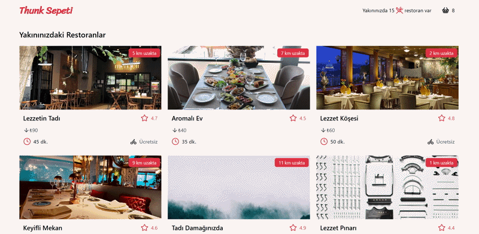

# Yemek-Sepeti-Clone

Basit bir Yemek Sepeti klonu — React + Vite + Redux + Tailwind ile hazırlanmış örnek uygulama.

## Açıklama

Bu proje, eğitim amaçlı geliştirilmiş bir yemek sipariş uygulaması klonudur. Uygulama restoranları, ürünleri ve sepete ekleme/çıkarma işlemlerini içerir.

## Ekran Görüntüsü



## Öne çıkan özellikler

- Restoran ve ürün listesi
- Ürünleri sepete ekleme / çıkarma
- Sipariş bilgisi sayfası
- Basit global durum yönetimi için Redux kullanımı

## Teknolojiler

- React (Vite)
- Redux
- Tailwind CSS
- json-server (örnek API için)

## Kurulum

Ön koşullar: Node.js ve npm yüklü olmalıdır.

1. Bağımlılıkları yükleyin:

```
npm install
```

2. Sahte API sunucusunu başlatın (opsiyonel, proje kökünde `db.json` mevcut):

```
npx json-server --watch db.json --port 5000
```

3. Geliştirme sunucusunu başlatın:

```
npm run dev
```

Üretim derlemesi oluşturmak için:

```
npm run build
npm run preview
```

## Proje yapısı (özet)

- `src/` — uygulama kaynağı
  - `api/` — API çağrıları
  - `components/` — tekrar kullanılabilir bileşenler
  - `pages/` — sayfa bileşenleri (`home`, `restaurant`, `cart`)
  - `redux/` — `store.js`, `actions/`, `reducers/`

## Notlar

- `db.json` içindeki veriler örnek amaçlıdır; json-server ile kolayca kullanılabilir.
- Tailwind ve Vite konfigürasyonları proje içinde hazırdır.

## Lisans

Bu proje örnek/ödev amaçlıdır. İsterseniz lisansı `MIT` olarak ayarlayabilirsiniz.

---

İlgili değişiklikleri commit / push yapmamı isterseniz söyleyin; yardımcı olayım.
